<p align="center">
  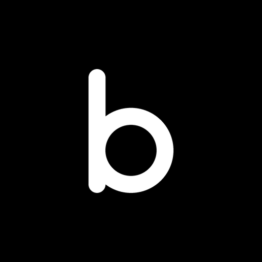
</p>

<h1 align="center">Birdy</h1>

<p align="center">
  <strong>Ein minimaler Android-Launcher.</strong><br>
  Reines Schwarz für OLED, schnell und ohne Schnickschnack.
</p>

<p align="center">
  <a href="../../releases/latest"></a>
  
  
  
</p>

<p align="center">
  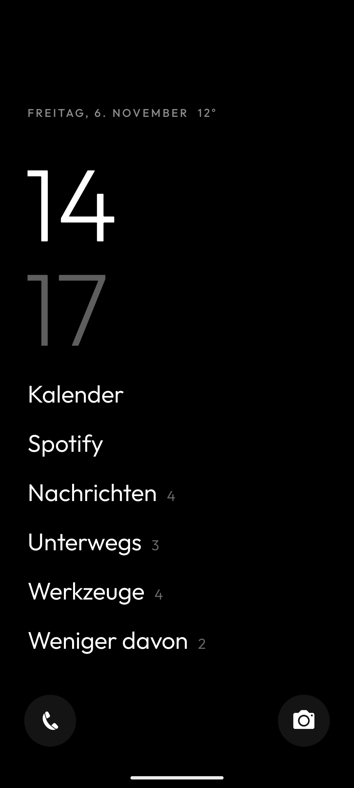
</p>

<p align="center">
  <a href="../../releases/latest"><strong>Birdy herunterladen</strong></a>
  ·
  <a href="CHANGELOG.md">Neuerungen</a>
  ·
  <a href="PRIVACY.md">Datenschutz</a>
</p>

## Warum Birdy?

- **Weniger Ablenkung:** Keine bunten App-Raster, nur Text in Schwarz und Weiß. Du öffnest, was du wirklich brauchst.
- **Schnell und klein:** Rund 140 KB und keine Libraries.
- **Privat:** Birdy hat keinen Internetzugriff, sammelt nichts und sendet nichts.
- **Hilft beim Aufhören:** Zeitlimits, Schonzeiten und eine Sperre für Shorts und Reels sind eingebaut.

## Startbildschirm

Große Uhr, Datum und auf Wunsch die Temperatur. Darunter liegen bis zu 7 Apps oder Gruppen, in den unteren Ecken je eine App als Icon.

<table>
  <tr>
    <td align="center" width="33%"><br><sub><b>Alles Wichtige auf einen Blick</b></sub></td>
    <td align="center" width="33%">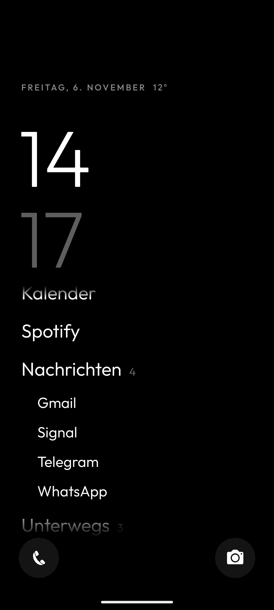<br><sub><b>Gruppen klappen beim Tippen auf</b></sub></td>
    <td align="center" width="33%">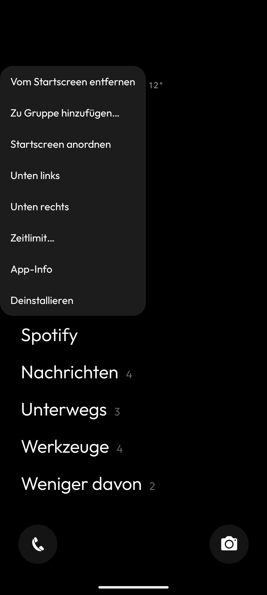<br><sub><b>Lange drücken für alle Optionen</b></sub></td>
  </tr>
</table>

- **Lange auf eine App drücken:** anheften, in eine Gruppe legen, als Eck-Icon setzen, Zeitlimit einstellen, App-Info öffnen oder deinstallieren.
- **Lange auf eine Gruppe drücken:** Apps auswählen, anordnen, umbenennen oder löschen.
- **Herunterwischen:** öffnet die Benachrichtigungen.

## Alle Apps und Suche

Hochwischen öffnet die Liste aller Apps mit Suche. Der beste Treffer bleibt weiß, die übrigen werden grau, und Enter startet ihn.

<table>
  <tr>
    <td align="center" width="50%">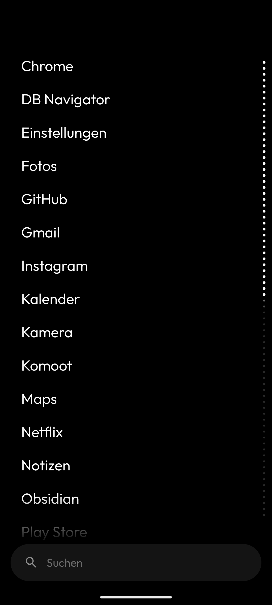<br><sub><b>Alle Apps, ein Wisch entfernt</b></sub></td>
    <td align="center" width="50%">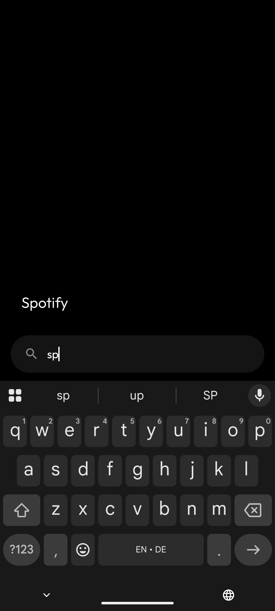<br><sub><b>Zwei Buchstaben reichen oft</b></sub></td>
  </tr>
</table>

Auf Wunsch findet die Suche auch Kontakte und bietet eine Websuche an. Die Tastatur kann gleich beim Hochwischen erscheinen, die Treffer können unten am Daumen liegen, und die Liste lässt sich nach Installationsdatum sortieren oder mit oft genutzten Apps beginnen.

## Weniger am Handy

### Bewusst öffnen und Zeitlimits

Apps können vor dem Öffnen fragen, wie lange du bleiben willst. Eine dünne Leiste oben zeigt dann die restliche Zeit. Dazu kommen pro App ein Tageslimit und Schonzeiten am Morgen und am Abend.

<table>
  <tr>
    <td align="center" width="33%">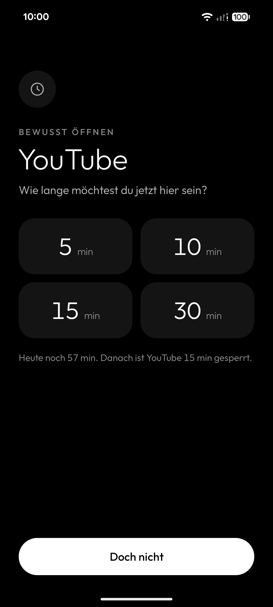<br><sub><b>Erst entscheiden, dann öffnen</b></sub></td>
    <td align="center" width="33%">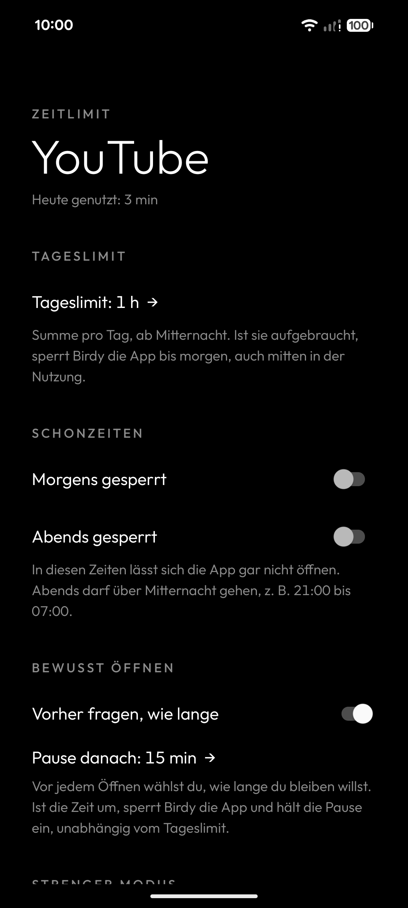<br><sub><b>Regeln pro App</b></sub></td>
    <td align="center" width="33%">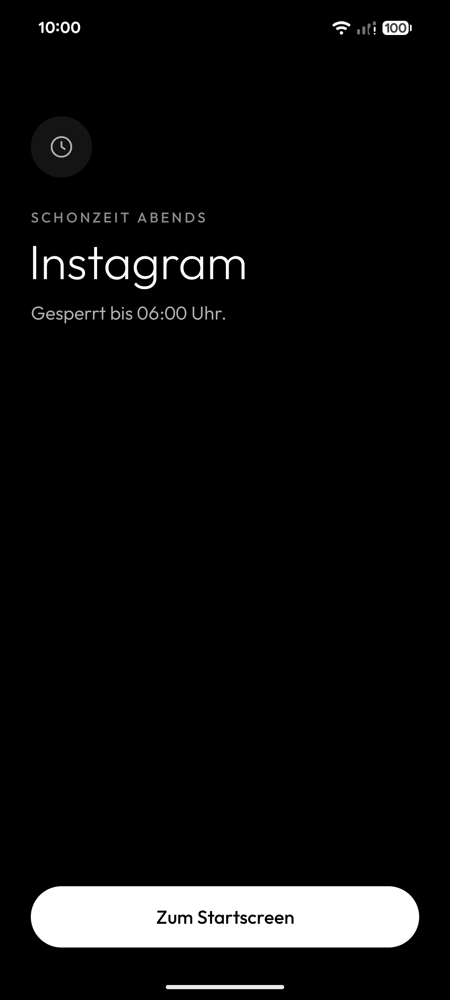<br><sub><b>Gesperrt heißt gesperrt</b></sub></td>
  </tr>
</table>

Im **strengen Modus** (Bedienungshilfe) greift das auch, wenn eine App an Birdy vorbei geöffnet wird, zum Beispiel über eine Benachrichtigung oder „Zuletzt verwendet“. Birdy erfährt dabei nur, welche App vorne ist, und liest keine Inhalte.

### Shorts und Reels

YouTube und Instagram bleiben nutzbar, nur der Player für Shorts und Reels nicht. Birdy verlässt ihn sofort oder erst, wenn deine Zeit für heute um ist. Die Bedienungshilfe dafür ist nur in diesen beiden Apps aktiv.

<table>
  <tr>
    <td align="center" width="50%">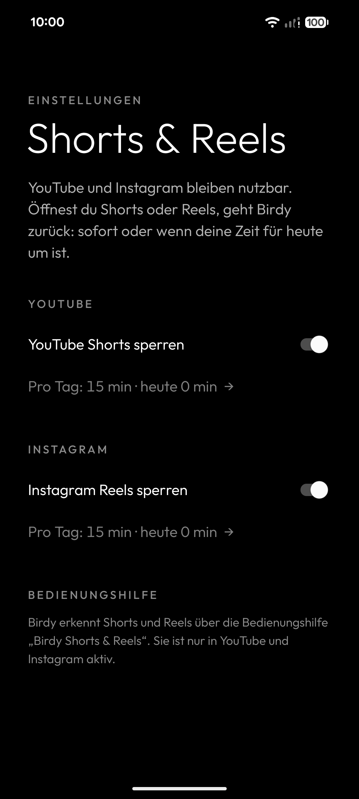<br><sub><b>Für beide eine eigene Tageszeit</b></sub></td>
    <td align="center" width="50%">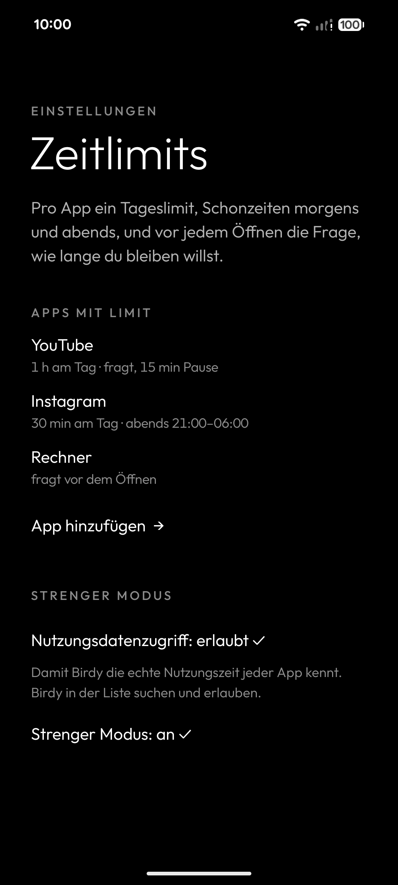<br><sub><b>Alle Limits im Überblick</b></sub></td>
  </tr>
</table>

## Einstellungen

Die App „Birdy“ erklärt die Einrichtung und enthält alle Einstellungen.

<table>
  <tr>
    <td align="center" width="50%">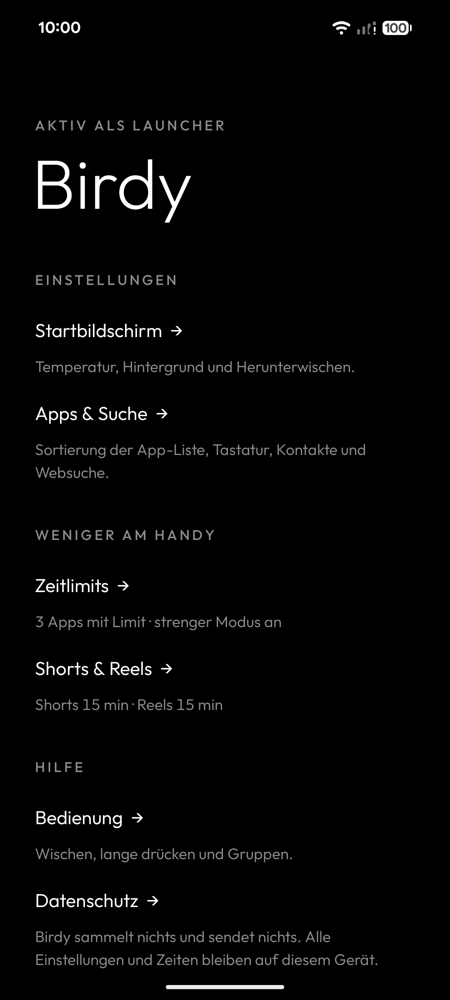<br><sub><b>Kurze Übersicht</b></sub></td>
    <td align="center" width="50%">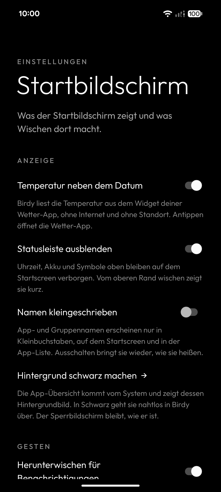<br><sub><b>Temperatur, Statusleiste, Kleinschreibung</b></sub></td>
  </tr>
</table>

## Installieren

1. Die APK aus den [Releases](../../releases/latest) laden und installieren. Birdy läuft ab Android 8.
2. Die App „Birdy“ öffnen. Sie erklärt, wie du Birdy als Startbildschirm festlegst, und springt direkt in die passende Einstellung.

Zeitlimits brauchen zwei Freigaben, Shorts und Reels eine eigene Bedienungshilfe. Beides brauchst du nur, wenn du die Funktion nutzt. Was Birdy wofür braucht, steht in der [Datenschutzerklärung](PRIVACY.md).

## Selbst bauen

```
./gradlew installRelease
```

Lokal wird mit dem Debug-Schlüssel signiert. Die GitHub-Pipeline baut bei jedem Push eine APK und hängt sie bei Tags (`v*`) an ein Release. Der Ablauf steht in [docs/RELEASING.md](docs/RELEASING.md).

## Schrift

[Outfit](https://github.com/Outfitio/Outfit-Fonts), SIL Open Font License (`LICENSE-Outfit-Font.txt`).
