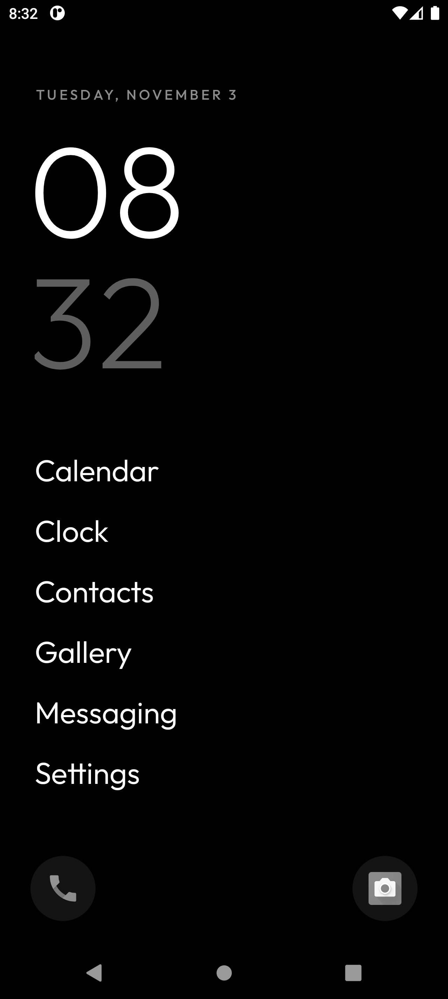

# Birdy

Ein minimaler Android-Launcher: schwarz-weiß, reines Schwarz für OLED, schnell und ohne Schnickschnack.



- Große Uhr mit Datum, darunter bis zu 7 Lieblings-Apps
- Unten links und rechts je eine App als Icon
- Hochwischen öffnet alle Apps mit Suche; der beste Treffer ist markiert und startet mit Enter, Herunterwischen die Benachrichtigungen
- Lange drücken auf eine App: anheften, als Eck-Icon setzen, App-Info, deinstallieren
- Optional: oft genutzte Apps oben in der Liste, Sortierung nach Installationsdatum, Tastatur gleich beim Hochwischen, Suchtreffer unten am Daumen, schwarzer Hintergrund für die App-Übersicht (Einstellungen in der Birdy-App)
- Keine Libraries, keine Berechtigungs-Abfragen, APK unter 100 KB

## Installieren

APK aus den [Releases](../../releases/latest) laden und installieren. Dann die App „Birdy“ öffnen: Sie erklärt kurz, wie du Birdy als Startbildschirm festlegst, und springt direkt in die passende Einstellung.
Ab Android 8.

## Bauen

```
./gradlew installRelease
```

Lokal wird mit dem Debug-Schlüssel signiert. Die GitHub-Pipeline baut bei jedem Push eine APK und hängt sie bei Tags (`v*`) an ein Release.

Schrift: [Outfit](https://github.com/Outfitio/Outfit-Fonts), SIL Open Font License (`LICENSE-Outfit-Font.txt`).
